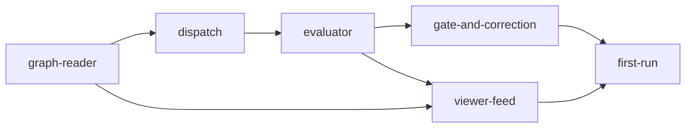

# 000 — GDAD build path (opening handoff)

Format follows `gddp-config/.handoffs/000-template.md`. This handoff opens the
project rather than closes a session, so it carries one extra heading, the
build path, under the Agent Section. Supersedes `docs/transition/gddp-rebuild-roadmap.md`
as the plan of record; that file stays until the doc cull decides its fate.

------------------------------------------------ Agent Section START

Date: 2026-10-11
Worktree: ~/repos/GDAD
Branch: main

## Empirical Reality

Main has invariants, origin/terminology docs, the blackbox-failure doc, two
prototypes, and no GDAD code. The `seed-graph` branch (570-line gdad.py, 7
nodes in a schema incompatible with the real graphs) was deleted today and
survives only as tag `archive/seed-graph`.

### Scope touched

- `docs/GDAD-BLACKBOX-FAILURE.md` (+)  commit 575fe1c
- `README.md` (+1 line, link to the above)
- `.handoffs/000-gdad-build-path.md` (+) this file
- branch `seed-graph` (−, tagged `archive/seed-graph`)

### Constrained areas touched

none

### Current Git state

Clean on main, pushed. No code. Tag `archive/seed-graph` holds the only prior
implementation; ~250 of its 570 lines (validation cases, status derivation,
reject cascade, and their tests) are reusable in idea, not in text, since the
schema field names change.

### Artifacts

- `docs/GDAD-BLACKBOX-FAILURE.md` - why GDAD exists; GDDP's observability failure with commit-level evidence
- https://claude.ai/artifact/12K6LUzfDKvyQnP7Lgd2EA - GDDP vs GDAD mechanism diagrams, guard table, full GDDP inventory with sizes
- `~/.claude/projects/-Users-sab-mini-repos-GDAD/memory/` - session decisions (gdad-decisions-2026-10-11.md), only other durable copy of the audits below

### Resume point

Step 0 below: doc cull and the open decisions, with Sab. No node files and no
code until every file on main has a stated reason to exist.

### Build path

**Decided (2026-10-11, Sab):**
- GDAD is GDDP 2.0: same loop, friction removed. Budget ~3k source lines total.
- Dispatch lives in GDAD, not aa-cli. Two projects was the first mistake.
- The 9 invariants in AGENTS.md are fixed. Everything written after them is reviewable.
- Node schema: `why` is the one human-written field. `title`, `depends_on`,
  `acceptance_criteria[{id,criterion}]`, `constraints`, `milestones` (~2) are the
  task, agent-draftable, human-admitted. No `status`, `unlocks`, `priority`,
  `allowed_execution_modes`, `required_artifacts`, envelope fields.
- Evaluator: typed closed questions graded against `why` (semantic drift) and
  breakage (functional drift). Read-only mid-pass at each milestone marker,
  final typed receipt bound to the attempt SHA. Pass is the only path to
  provisional. Never halts, retries, or edits a node. May append a corrective
  node (provisional, with `authored_by`, `triggered_by`, `corrects`). Reject
  cascades to dependents.
- Executor is external and owns its lifecycle. It receives milestones in the
  packet and touches a marker per milestone and on completion.
- Journal file is the queue and the lock. Receipts are files. Status derives on read.
- Viewer is shape-shifter-graph, fed by `gdad status --json`. Node creation
  tooling stays in aa-cli.

**Open (Sab decides):**
1. Read GDDP-schema node files tolerantly (ignore extra fields, accept
   `acceptance`/`acceptance_criteria`, `id`/`node_id`) or migrate the 270
   existing nodes. Recommendation: tolerant read first.
2. `why` enforcement: none, evaluator-judged, or length rule.
3. Completion signal: done marker (recommended) vs worktree quiescence.
4. Corrective-node lifecycle: own node, or part of evaluator + gate.
5. Fate of `docs/transition/` (4 roadmap drafts, ~1000 lines) and
   `docs/observability/` (describes a runtime that violates invariant 7).
6. Which invariants copy stays: AGENTS.md JSON, `docs/invariants/invariants.md`
   prose, or `docs/invariants/AGENTS.md` projection. Three today.
7. Fate of `prototypes/shadow-evaluator/` (question set is the evaluator seed;
   code targets old GDDP receipts) and `.pi/workflows/` (practice, undocumented).
8. README expands GDAD; terminology doc says don't. One wins.

**Audit findings (Sonnet, today; full text only in chat):**
- GDDP schema never grew; all fields present from first commit. `depends_on` and
  `unlocks` drifted (69 edges unreciprocated). `status` in YAML conflicted with
  derived state (nodes `complete` atop `pending` deps). `priority` 72% high.
  `why` worked when a human wrote it, restated the title when bulk-drafted.
- gddp-runtime: 195 of 757 commits were fixes. Heartbeat/reconciler 62,
  adapters 52, verification 30. Dispatch was 9 layers / 6.5k lines; a
  one-function rewrite is ~400. Evaluator 4.9k in two lanes; one lane first.
- Guards backed by incidents: duplicate-dispatch block, index.lock retry,
  evaluator crash isolation, publication serialization. Speculative: gate
  tokens, base-SHA binding, patch spool, orchestrator pack, continuity policy,
  capability matrix. Executor supervision (idle grace, turn timeouts) was
  constant friction and is out of scope by invariant 7.
- GDDP's verdict became typed late; before that prose. Either way its only live
  reader was a retry heuristic. `gddp watch` printed `tail -F <path>`.

**Node sketch (NOT node files; `why` is Sab's to write):**

| id | builds | milestones (sketch) |
|---|---|---|
| graph-reader | tolerant loader, `check`, status derived from journal+receipts, frontier | validator with failing-case tests; `status` prints aa-cli's real 31-node graph |
| dispatch | frontier → packet (why, criteria, constraints, milestones, marker paths) → one adapter command template; journal line | packet rendered and one node dispatched by hand; executor touches a marker |
| evaluator | typed questions vs `why`; mid-pass per marker; final receipt bound to SHA; pass → provisional | final-only receipt on a real attempt; mid-passes fire on markers |
| gate-and-correction | `accept`/`reject` with cascade; evaluator-appended corrective node with lineage, provisional entry | reject cascade exercised; one corrective node on a real drift finding |
| viewer-feed | `status --json` in the shape shape-shifter-graph reads: nodes, provisional marks, receipts, milestone timeline | static export renders in the viewer; live refresh when a receipt lands |
| first-run | GDAD's own graph through the loop once: dispatch → markers → eval → visible → accept | one node round-trips; one corrective node round-trips |

Granularity test: a node must carry two milestones under one `why`. Anything
that can't is a milestone of another node. Six is the expected count; fewer is fine.

**Not being built:** job database, adapter hierarchy, executor supervision or
timeouts, patch return, gate tokens, export/restore, TTY-gated commands,
cadence timer, second evaluator lane, second adapter, any new UI.

**Sequence:**
0. Doc cull + open decisions 1–8, with Sab. Every surviving file gets a reason.
1. Sab writes six `why`s. Agent drafts the task fields. Sab admits.
2. graph-reader, proven against aa-cli's real graph.
3. dispatch + evaluator, final-pass only, on one real node.
4. viewer-feed, so step 5 is watched from the viewer not from chat.
5. first-run. Mid-passes and corrective nodes land here, not before.

------------------------------------------------ Agent Section END

------------------------ Do NOT edit this file past this point

## Narrative / Trajectory (SAB ONLY)

### Intent going into/at start of session

### Interpretation of how the session went

### Friction experienced or anticipated

### What's Next (Momentum or Lack Thereof)
