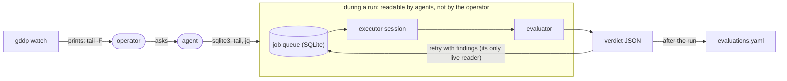

# The blackbox failure

What GDDP got wrong about observability, with the evidence. This is the reason
GDAD exists as a daily tool rather than a rebuild of the runtime. Read with
[origins](GDAD-ORIGINS.md) and invariant 8 in [the invariants](invariants/invariants.md).

## The failure in one sentence

GDDP was legible to agents and opaque to its operator. Every state the loop
produced was on disk and queryable. The only reader with a usable interface was
an agent running shell primitives, so every question about a live run became a
conversation, and the human-facing commands told the operator which other tool
to go run.



## What it felt like

The operator went to the best available model, repeatedly, asking for
visibility into a running graph. The answers were long shell pipelines built
from unix primitives, to be memorised and typed into another terminal. The one
"watch" feature that got built displayed the command to run elsewhere. Turning
on the TV and getting a single screen that says "use a radio".

The two or three genuinely good GDDP runs suffered this too. Trust in them was
built by interrogating agents with targeted questions after the fact, not by
looking at anything.

## Evidence

- **`gddp watch`, first version.** gddp-config commit `5d51128` (2026-08-13),
  "package live executor view under watch and jobs live". The single-attempt
  view ends with:
  ```python
  print("\n  live stream:  tail -F " + str(info.get("events_path") ...))
  ```
  and the fleet view with:
  ```python
  print("  events:    tail -F <spool>/…/events.jsonl  (path in single view)")
  ```
- **`gddp watch`, second version.** After the 2026-09-14 split into
  `scripts/cli_watch.py` (850 lines), the live path prints the command to
  stderr and `os.execvp`s into a different tool, `agent-obs`, reading a
  different database (`~/.local/share/agent-obs/agent-obs.db`). The fallback
  prints `tip: gddp watch --all · gddp jobs live`.
- **The verdict had one live reader.** The evaluator in
  `gddp-runtime/scripts/runtime/verification/` wrote a typed `VerdictReceipt`
  (late in the project; prose before that). It landed in the `acceptance_check`
  SQLite column and an `evaluations.yaml` export. The only code that acted on
  it was `retry_budget`, a capped re-dispatch heuristic. Nothing surfaced a
  drift finding to the operator while the run was live.
- **The doc that was never written.** gddp-runtime contains a file named
  `The Problem with GDD is verification and observability.md`. It is 57 bytes:
  the title and nothing else. The problem was named and not addressed.
- **The origin account.** [origins](GDAD-ORIGINS.md): after a go-ahead, the
  dispatcher did not dispatch, and this was discovered the next morning. The
  owner's lesson at the time: "black boxes and null observability are no longer
  acceptable." The watch feature above was built two months after that lesson.

## Why it happened

The data model was designed for the loop, not for the operator. State in
SQLite, events in JSONL spools, transcripts in executor sessions: each correct
for the component that wrote it, none a surface. When visibility was requested,
the responding agent had a perfectly good interface to all of it, the shell,
and handed that interface back. From the agent's side the system was not a
black box at all. The asymmetry was invisible to the thing being asked to fix it.

## What GDAD does instead

- Every stage writes a file the operator can open: node YAML, journal, receipt.
  Nothing derivable is stored; nothing stored needs a query to read.
- The evaluator's receipt has two readers from the start: the frontier, which
  moves only on a passing receipt, and the viewer, which shows every receipt
  including drift, at the milestone it was found, not after the run.
- Milestones inside each node give the evaluator eyes mid-run and give the
  operator a timeline with named points instead of a tail of events.
- Invariant 8 is the rule: exercising authority must not depend on an agent as
  the sole interpreter or operator. A feature that prints a command for the
  operator to run elsewhere fails this invariant and is not observability.
- The viewer is an existing interactive tool (shape-shifter-graph), not a
  terminal command. "Observed something going wrong" has to be followed by
  "acted on it" from the same surface, or the observation was only a log.
