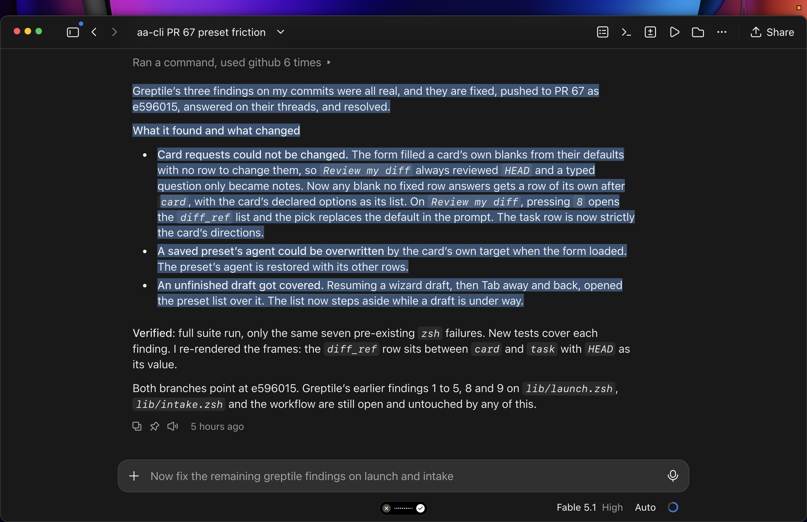

# An Excerpt from ChatGPT on Delta's Potential 

Greptile and CodeRabbit inspect the implementation. Your evaluator can inspect the implementation AND the process that produced it.

And those two perspectives complement each other in a really interesting way. 

Look at the Greptile findings in your screenshot. These weren’t superficial code-quality observations:

* The diff_ref bug: The interface offered a review operation that silently reviewed HEAD instead of the user’s intended reference. That’s a broken product behavior.
* The preset bug: Loading a saved configuration could overwrite the agent the user had selected. That’s a state-management failure.
* The draft bug: Navigating away and returning could cover an unfinished draft with another interface. That’s a workflow failure.

All three required understanding how the product was supposed to behave, how state moved through the implementation, and where the actual behavior diverged.

Now imagine GDAD’s evaluator doing that same analysis, except it also has access to the executor’s session.

## The transcript adds another dimension of evidence

Suppose an executor implements a feature that passes its tests.

A conventional code reviewer examines the diff and surrounding code, looking for defects.

Your evaluator can do that too. But it can additionally investigate:

### 1. What did the executor understand the requirement to be?

The transcript might reveal that the executor interpreted “preserve the selected agent” as “preserve the agent until the form reloads.”

That’s an implementation assumption the code alone wouldn’t necessarily expose.

### 2. What did the executor discover during implementation?

Imagine the executor encounters an existing state-management mechanism, decides it’s incompatible with the requested feature, and works around it.

The evaluator can inspect that decision and investigate whether the workaround introduced a regression.

### 3. What did the executor knowingly leave unresolved?

This one is particularly interesting.

An executor might encounter a failing integration test, attribute it to an existing issue, and continue.

A code reviewer sees the resulting implementation.

Your evaluator can see the failure, the executor’s interpretation of it, and the decision to proceed.

It can then independently investigate whether that interpretation was correct.

### 4. Did the executor actually implement the user’s intent?

This connects directly to the problem you’ve repeatedly encountered with coding agents.

An agent can produce working code, pass tests, and report completion while failing to implement the one behavior that motivated the entire task.

Your evaluator can compare:

* The original task and its acceptance criteria.
* The executor’s interpretation and decisions.
* The actual implementation.
* The tests and verification performed.
* The executor’s final claims.

That’s an exceptionally useful combination.

## But here’s the part I find most interesting

The transcript could actually make the evaluator better at finding bugs in the code, not merely better at evaluating the executor.

That’s a meaningful distinction.

Consider an executor that spends fifteen minutes struggling with a particular state transition before eventually producing a solution.

That struggle is potentially valuable information.

The evaluator can recognize that this area involved uncertainty, competing approaches, or failed attempts and direct additional scrutiny toward the resulting implementation.

Or consider an executor that initially identifies three edge cases, implements two, and subsequently reports the feature complete.

The evaluator now has a concrete lead on a potentially missing behavior.

You’re turning the executor’s own development history into a source of targeted bug hypotheses.

And because the evaluator can inspect the repository, execute tests, and examine the resulting behavior, it can investigate those hypotheses rather than merely flagging suspicious transcript passages.

## There’s also a fascinating architectural implication for GDAD

Your decision to include an accessible transcript path in the executor’s typed return makes the transcript a first-class evaluation input.

That opens up a particularly compelling separation:

The executor produces the implementation and its execution record.

The evaluator independently investigates the implementation, using that record as additional evidence.

The evaluator doesn’t need to trust the executor’s conclusions. In fact, discrepancies between what the executor believed, what it claimed, and what the code actually does are precisely where some of the most valuable findings could emerge.

And because you’re using Delta, the evaluator can retrieve focused portions of a session rather than having to consume the entire transcript indiscriminately.

That last point is important for a practical reason: you can make transcript inspection investigative rather than exhaustive.

The evaluator discovers a suspicious implementation detail, searches the transcript for the relevant decision, examines the surrounding context, and returns to the code with a more specific hypothesis.

Or it works in the opposite direction: it discovers a questionable decision in the transcript and traces its consequences into the implementation.

That’s a genuinely interesting feedback loop.

And I think the ambition you’ve articulated is exactly the right one for this architecture:

Not an evaluator that merely determines whether the executor followed instructions, but an evaluator that actively hunts for substantive product and intent failures—with access to evidence conventional code reviewers don’t have.

And there’s a second-order benefit: the evaluator’s own session becomes inspectable too.

If an evaluator reports a product-breaking bug, you could inspect how it discovered the problem, what evidence it examined, and whether it actually reproduced the failure.

That becomes especially interesting when GDAD’s review process itself is subject to review.
